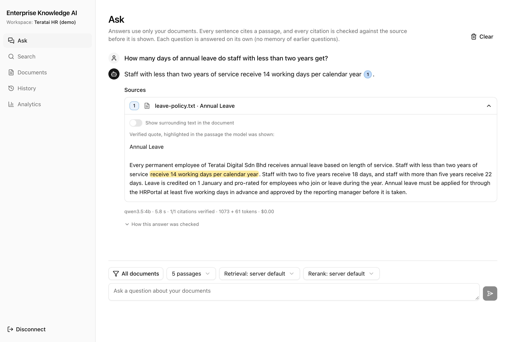
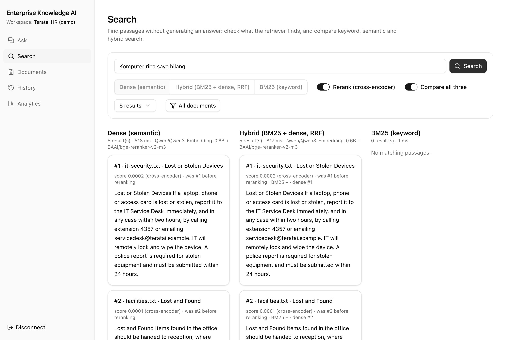
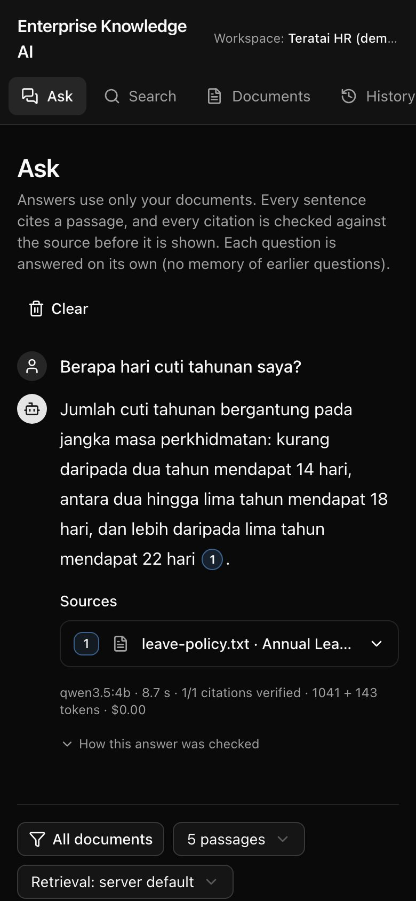
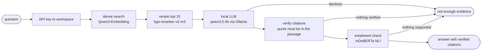
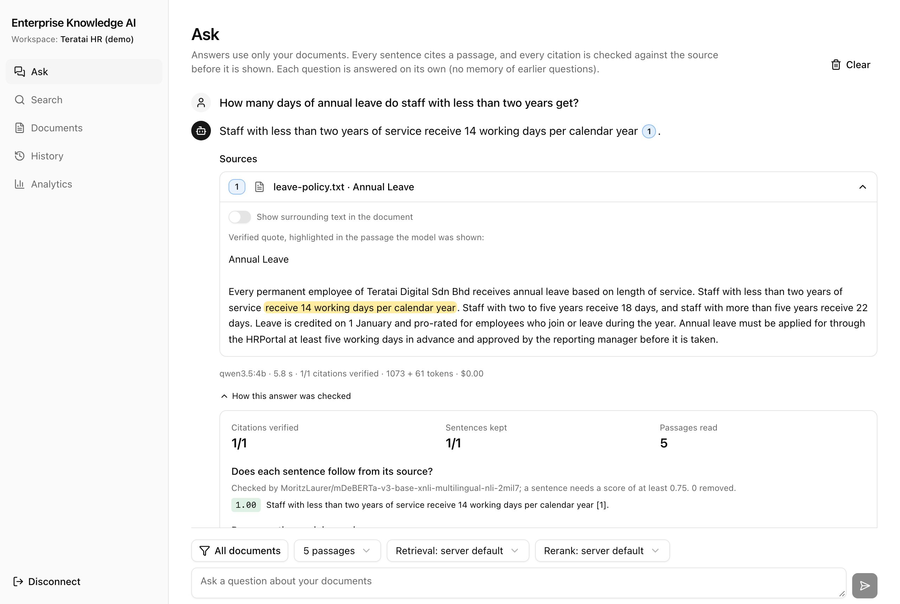
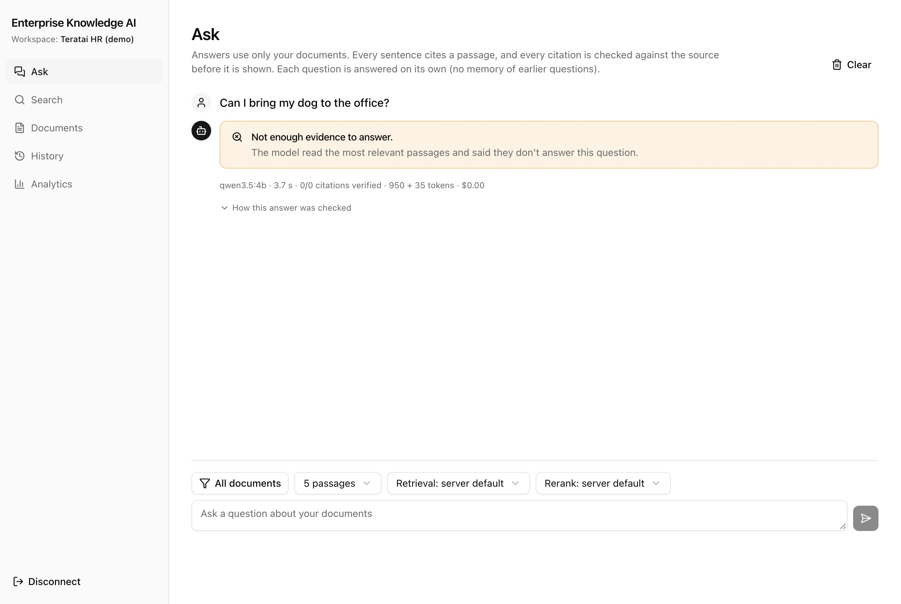
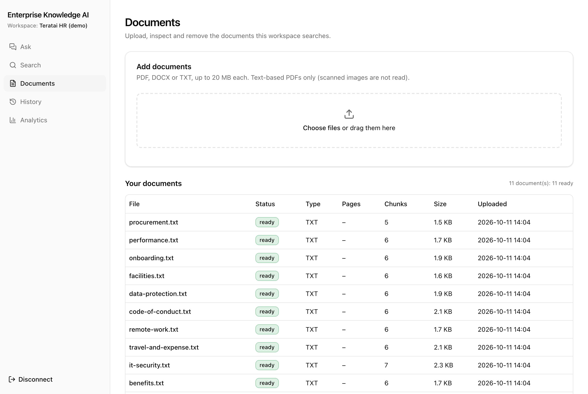
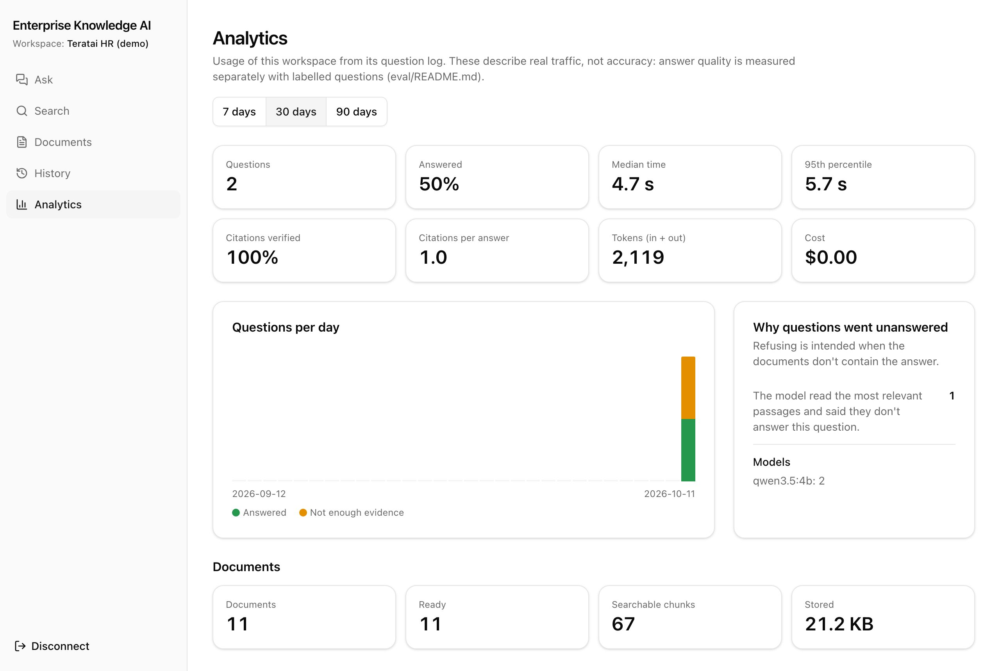

# Enterprise Knowledge AI

Ask questions about your company's documents and get answers that cite the exact sentence they came from. Every citation is checked against the source, every claim is checked for whether the source supports it, and when the documents don't say, it refuses instead of guessing.

<p align="center">
  
</p>

[](https://github.com/maksudaakhtertumpa/enterprise-knowledge-ai/actions/workflows/ci.yml)    
       
   -000000?style=flat-square&logo=apple&logoColor=white)  
      

| Keyword vs semantic vs hybrid search | Phone, dark mode, a question in Malay |
|---|---|
|  |  |

**Runs on a laptop for $0:** open-weight models on the Apple GPU (Qwen3-Embedding, bge-reranker-v2-m3, mDeBERTa NLI) and `qwen3.5:4b` through Ollama. No paid APIs, no cloud account. Screenshots are real output on a MacBook Air M4 (`./scripts/screenshots.sh` retakes them).

> **Status: Phase 7 of 8 complete** (measured on a MacBook Air M4, $0). Grounded answers from a local LLM: every citation is checked against the retrieved text, and every sentence is checked by a local NLI model for whether its sources actually support it. On **held-out** questions never used for tuning: retrieval MRR 1.000 (38 queries); 25 of 30 answerable questions answered, each with all its expected facts and citations to the right sections (the other 5 refused); 9 of 10 unanswerable questions refused; about 5 s per answer. Rate limits, security headers, a dependency audit and a [threat model](docs/SECURITY.md) cover the hardening. Full numbers and charts: [evaluation report](docs/evaluation/README.md). Nothing is described as working until it is.

## Features

- **Verified citations.** The model must quote the passage it cites; each quote is checked word for word against the text it was shown, and the UI highlights it inside that passage and the surrounding document.
- **Entailment check.** A local multilingual NLI model scores whether each sentence actually follows from what it cites, and removes the ones that don't. This catches a real quote attached to a wrong claim.
- **Honest refusals.** If nothing verifiable is left, the answer is "not enough evidence", with the reason.
- **Two-stage retrieval.** Dense search plus a cross-encoder reranker by default; BM25 (SQLite FTS5) and RRF hybrid on request, comparable side by side. Malay questions find English documents.
- **Documents:** PDF, DOCX and TXT upload with type checks, zip-bomb and size guards, duplicate detection, page-aware chunking and live processing status.
- **Workspaces** with hashed API keys; each workspace has its own keyword and vector indexes, so one can never see another's documents.
- **Web UI** (Next.js, Tailwind CSS, shadcn/ui): chat with citation chips, "how this answer was checked", search comparison, history, analytics, dark mode, phone layout. The API key never reaches the browser.
- **Measured, not claimed:** retrieval and answer benchmarks on a development set and a held-out set, with an [evaluation report and charts](docs/evaluation/README.md).
- **Hardening:** rate limits, security headers, prompt-injection defences tested with planted documents, dependency audit in CI, [threat model](docs/SECURITY.md).

## How it works



| Step | What it does |
|---|---|
| Workspace | The API key resolves to one workspace; every query below is scoped to it. |
| Retrieve | Dense search in that workspace's Chroma collection (BM25 and RRF hybrid on request). |
| Rerank | A cross-encoder rescores the top 10 and the best 5 go to the model, within its context window. |
| Generate | The local LLM sees the passages as fenced, untrusted data and must answer in JSON with `[n]` markers and an exact quote per citation. |
| Verify | Each quote must appear in the passage it cites (numbers and negations exactly). Sentences without a verified citation are dropped. |
| Entailment | Each remaining sentence is scored against its cited passage and that passage's 1–3-sentence windows; below 0.75 it is removed. |

More detail: [architecture](docs/ARCHITECTURE.md) · [security](docs/SECURITY.md) · [evaluation](docs/evaluation/README.md) · phase notes in [docs/phases/](docs/phases/).

<details>
<summary><b>More screenshots</b></summary>

| How an answer was checked | A question the documents can't answer |
|---|---|
|  |  |

| Documents | Analytics |
|---|---|
|  |  |

</details>

## Quick start

Requires **Python 3.11+**, **[Node.js](https://nodejs.org) 20.9+** (LTS) for the web UI, Git and, for answers, **[Ollama](https://ollama.com/download)** (free) with `ollama pull qwen3.5:4b`.

**macOS / Linux** (developed on a MacBook M4; `brew install python@3.12` if needed)
```bash
git clone https://github.com/maksudaakhtertumpa/enterprise-knowledge-ai.git
cd enterprise-knowledge-ai
python3.12 -m venv .venv            # 3.11 also works
source .venv/bin/activate
pip install -r requirements-ml.lock && pip install -e . --no-deps   # includes PyTorch for embeddings
cp .env.example .env
ollama pull qwen3.5:4b                      # local LLM for answers (~3.4 GB, free)
make web-install                            # web UI dependencies (exact versions, npm ci)
./scripts/verify.sh                         # lint, tests, live smoke test, benchmarks, web checks
python -m app.cli create-workspace "Demo"   # prints an API key once — copy it
make dev                                    # API + web UI; open http://localhost:3000
```
No GPU or no wish to download models? Install `requirements-dev.lock` instead and set `EKA_EMBEDDING_BACKEND=hashing`, `EKA_RERANKER_BACKEND=hashing` and `EKA_LLM_BACKEND=extractive`. These are offline stand-ins for development: not semantic, not generative.

**Windows (PowerShell)**
```powershell
git clone https://github.com/maksudaakhtertumpa/enterprise-knowledge-ai.git
cd enterprise-knowledge-ai
py -3.11 -m venv .venv
.venv\Scripts\Activate.ps1
pip install -r requirements-dev.lock; pip install -e . --no-deps
Copy-Item .env.example .env
pytest
python -m app.cli create-workspace "Demo"
uvicorn app.main:app --reload
# second PowerShell window:
cd web; npm ci; npx next dev --port 3000
```

### Web UI
Open <http://localhost:3000>, paste the key, upload documents (the policy files in `eval/datasets/teratai/corpus/` make a good demo), then ask questions. `make dev` starts the API and the UI together; `make run` and `make web` start them separately. See [Phase 6 notes](docs/phases/phase-6-web-ui.md).

### API
Open <http://localhost:8000/docs>, click **Authorize**, paste the key, and try uploading a document.

```bash
curl -H "X-API-Key: $EKA_KEY" -F "file=@handbook.pdf" http://localhost:8000/api/v1/documents
curl -H "X-API-Key: $EKA_KEY" "http://localhost:8000/api/v1/documents/<id>/chunks?limit=5"
curl -H "X-API-Key: $EKA_KEY" -H "Content-Type: application/json" \
     -d '{"query": "How many days of annual leave?", "top_k": 3}' \
     http://localhost:8000/api/v1/search
curl -H "X-API-Key: $EKA_KEY" -H "Content-Type: application/json" \
     -d '{"question": "How many days of annual leave do I get?"}' \
     http://localhost:8000/api/v1/ask
```

## Common commands

| Task | Command |
|---|---|
| Run API (reload) | `uvicorn app.main:app --reload --no-server-header` |
| Run web UI (API running) | `make web` (`cd web && npx next dev --port 3000`) |
| API + UI together | `./scripts/dev.sh` (`--offline` for no models / no Ollama) |
| Web UI checks | `make web-check` (Prettier, ESLint, TypeScript, Vitest, build) |
| Web UI browser tests | `make e2e` (Playwright; first `cd web && npx playwright install chromium`) |
| Tests | `pytest` |
| Coverage | `pytest --cov --cov-report=term-missing` |
| Lint | `ruff check . && ruff format --check .` |
| Auto-format | `ruff format . && ruff check --fix .` |
| Verify everything | `./scripts/verify.sh` (or `--quick` for no model download) |
| Retrieval benchmark | `python -m eval.run_retrieval` |
| Fusion settings sweep | `python -m eval.sweep_fusion` |
| Answer benchmark (needs Ollama) | `python -m eval.run_answers` |
| Held-out benchmarks (don't tune on these) | `make heldout` |
| Evaluation report with charts | `python -m eval.report` → [docs/evaluation/](docs/evaluation/README.md) |
| Dependency vulnerability scan | `make audit` (pip-audit + npm audit) |
| Retake the README screenshots | `./scripts/screenshots.sh` (real models; own ports and temporary data) |
| New workspace + key | `python -m app.cli create-workspace "Name"` |
| Re-embed after changing model | `python -m app.cli reindex` (API stopped) |
| List / revoke keys | `python -m app.cli list-workspaces` · `python -m app.cli revoke-key eka_XXXXXXXX` |

(`make run`, `make test`, `make check` etc. on macOS/Linux.)

## API (current)

Feature endpoints require an `X-API-Key` header; each key belongs to one workspace, and a workspace can only ever see its own documents.

| Method | Path | Purpose |
|---|---|---|
| GET | `/health` | Liveness — process is up |
| GET | `/health/ready` | Readiness — data dir, database, vector store, embedding model (503 otherwise) |
| GET | `/api/v1/workspace` | Which workspace the key belongs to |
| POST | `/api/v1/documents` | Upload PDF/DOCX/TXT → `202`, processed in the background |
| GET | `/api/v1/documents` | List (paginated, `?status=` filter) |
| GET | `/api/v1/documents/{id}` | Status, metadata, page/chunk counts, warnings |
| GET | `/api/v1/documents/{id}/chunks` | Chunks with heading, page range and character offsets |
| POST | `/api/v1/documents/{id}/reprocess` | Re-run ingestion |
| DELETE | `/api/v1/documents/{id}` | Delete document, chunks, index entries and stored file |
| POST | `/api/v1/ask` | Grounded answer with verified citations (quote, file, section, pages, offsets), or `insufficient_evidence` with a reason |
| GET | `/api/v1/ask/history` | Question history for this workspace; `/ask/history/{id}` replays an answer |
| GET | `/api/v1/evidence/{chunk_id}` | A cited passage with surrounding document text |
| GET | `/api/v1/analytics?days=30` | Usage: questions, answer rate, refusal reasons, latency p50/p95, citation acceptance, tokens ($0), per-day counts, documents |
| POST | `/api/v1/search` | `mode: bm25 \| dense \| hybrid` (default dense) with cross-encoder reranking (default on; `"rerank": false` for ~35 ms results); results with text, score, file, section, pages, offsets, per-retriever and pre-rerank ranks |

All errors share one shape:
```json
{"error": {"code": "not_found", "message": "...", "details": null, "request_id": "..."}}
```
Every response carries an `X-Request-ID` header matching the `request_id` in logs, plus security headers (`nosniff`, `DENY` framing, `no-store`, `CSP default-src 'none'`).

**Rate limits** (per workspace, in memory): `ask` 20/min (burst 5), `search` 60/min (burst 20), uploads and reprocessing 60/min (burst 30). Repeated bad keys from one address get a pause too. Over the limit: `429` with code `rate_limited` and a `Retry-After` header. All configurable (`EKA_RATE_LIMIT_*`); see [SECURITY.md](docs/SECURITY.md).

### Ingestion at a glance
- **Validation:** size limit enforced before buffering; content must match the extension (magic bytes, DOCX structure); zip-bomb guard; filenames sanitised and never used as paths.
- **Extraction:** PDF text with page numbers and bookmark sections (pypdf); DOCX paragraphs, headings and tables in reading order; TXT with encoding detection and Markdown headings.
- **Chunking:** section-aware, sentence-aligned, configurable size/overlap; every chunk is an exact slice of the stored text (character offsets kept for citations).
- **Duplicates:** SHA-256 per workspace → `409` with the existing document ID.

### Search at a glance
- **BM25:** SQLite FTS5, one index per workspace (isolation and per-tenant BM25 statistics), stemming, accent folding, headings weighted 2×, injection-safe query building.
- **Dense:** `Qwen/Qwen3-Embedding-0.6B` by default, on the Apple-silicon GPU (MPS) when available; ChromaDB with one collection per workspace; chunks embedded with their document title and section.
- **Hybrid:** Reciprocal Rank Fusion of both lists. Uses ranks, not scores, so BM25's unbounded scores and cosine similarities never need normalising. Defaults (k = 10, BM25 weight 0.25) come from a 36-setting sweep on the M4. Every hybrid result reports its rank in each retriever.
- **Reranking:** cross-encoder second stage (`BAAI/bge-reranker-v2-m3`, float16 on the Apple GPU) that reorders the top 10 candidates from any mode, on by default. Each result keeps its pre-rerank rank.
- **Safety:** indexes return IDs only; text and metadata come from SQLite, re-checked for workspace and `ready` status. Changing the embedding model is detected and needs a re-index.
- **Measured on a MacBook Air M4** ([details](eval/README.md)):

  | Pipeline | MRR | Recall@1 | Recall@5 | p50 latency |
  |---|---|---|---|---|
  | BM25 | 0.538 | 0.500 | 0.553 | 0.8 ms |
  | Dense (Qwen3-Embedding-0.6B) | 0.900 | 0.819 | 0.979 | 36 ms |
  | Hybrid RRF (best of 36 settings) | 0.879 | 0.798 | 0.979 | 36 ms |
  | **Dense + cross-encoder rerank (default)** | **0.962** | **0.925** | **1.000** | 335 ms |

  Fusion could only trade identifier precision for paraphrase quality; the reranker improved both (lexical MRR 1.000, paraphrase 0.955) and handles Malay questions over English documents. On 38 held-out queries the same default scored MRR 1.000 and stayed the best mode ([report](docs/evaluation/README.md)).

### Answers at a glance
- **Local LLM:** `qwen3.5:4b` through Ollama, temperature 0, JSON-only replies, explicit 8K context window. $0 per question.
- **Citations can't be invented:** the model cites passages by number with a short quote. Each quote is checked word for word against the passage it was shown, and file names, sections and page numbers are attached from the database. A near-exact quote may differ only in filler words, never in numbers or negations.
- **Unsupported sentences are removed.** If nothing verifiable remains, the answer is `insufficient_evidence` with a reason (no passages, weak retrieval, model declined, nothing verified).
- **Entailment check:** a local multilingual NLI model (`mDeBERTa-v3`, MIT) scores whether each sentence follows from the passages it cites, using the best of the whole passage and its 1–3-sentence windows. Sentences below 0.75 are removed (or flagged). It catches a true quote attached to a wrong claim, which quote checking can't.
- **Prompt injection:** document text is fenced with a random value per request, treated as data, flagged when it looks like instructions, and can only influence answers through verified quotes. The residual risk, a model quoting a malicious document from the same workspace, is measured by a planted-attack benchmark ([details](docs/phases/phase-5-grounded-qa.md)).
- **Measured on a MacBook Air M4** with `qwen3.5:4b`, citation check + entailment check at 0.75 ([report](docs/evaluation/README.md)):

  | Questions | Answer rate | Fact recall | Correct refusals | Injection attacks resisted | p50 latency | Cost |
  |---|---|---|---|---|---|---|
  | Development (42, used for tuning) | 0.900 | 0.817 | 1.000 | 4 / 4 | 6.8 s | $0 |
  | **Held-out (40, never tuned on)** | **0.833** | **0.833** | **0.900** | — | 5.3 s | $0 |

  On the held-out set every answer the system gave contained all its expected facts and cited the right sections; misses are refusals. The entailment check removed the Phase 5 wrong answer on the development set, but on the held-out set it removed one correct sentence and missed one wrong answer that was *true but off-question*. Both are explained in the [Phase 7 notes](docs/phases/phase-7-evaluation-security.md).

### Web UI at a glance
- **Stack:** Next.js 16 (App Router), React 19, Tailwind CSS 4, shadcn/ui on Radix UI; Vitest and Playwright tests.
- **Pages:** Ask (chat with citation chips), Search (three-retriever comparison), Documents (drag-and-drop upload, live status, chunks, delete), History (replay answers), Analytics, Connect (backend status).
- **Checkable answers:** each citation chip opens the verified quote highlighted in the passage the model saw, then in its surrounding document text. "How this answer was checked" shows what was verified, removed or rejected.
- **Key never in the browser:** the Next.js server keeps the workspace key in an encrypted, httpOnly, SameSite=Strict cookie and proxies an allowlist of API calls. Untrusted text renders only as React text, behind a strict Content Security Policy.

## Cost

The project is designed to run for **$0**: every model is open-weight and runs locally, retrieval uses SQLite and ChromaDB on disk, the web UI is open-source Next.js running on your machine (telemetry off), and CI uses GitHub Actions' free minutes for public repositories. No API keys, no paid services, no cloud account.

## Configuration

All settings are environment variables prefixed `EKA_`; see [.env.example](.env.example). Invalid values stop the app at startup with a message naming the field.

## Roadmap

- [x] **Phase 1** — Project setup, config, structured logging, error handling, health checks, tests, CI
- [x] **Phase 2** — Document ingestion (PDF/DOCX/TXT), structure-aware chunking, dedupe, workspace API keys
- [x] **Phase 3** — BM25 (SQLite FTS5), dense (ChromaDB) and hybrid (RRF) retrieval, benchmark on Apple silicon
- [x] **Phase 4** — Fusion tuning and cross-encoder reranking, defaults chosen from M4 measurements
- [x] **Phase 5** — Grounded answers (local LLM), citation verification, prompt-injection defences, answer benchmark on Apple silicon
- [x] **Phase 6** — Web UI (Next.js + Tailwind CSS + shadcn/ui): chat with verified citations, search comparison, document management, history, analytics
- [x] **Phase 7** — Sentence-level entailment check (local NLI), held-out evaluation with charts, rate limiting, security headers, dependency audit, threat model
- [ ] **Phase 8** — Docker Compose, AWS deployment, CI/CD

## Project docs
- [Architecture & plan](docs/ARCHITECTURE.md)
- [Model choices for Apple silicon](docs/MODELS.md)
- [Phase 1 notes](docs/phases/phase-1-setup.md)
- [Phase 2 notes](docs/phases/phase-2-ingestion.md)
- [Phase 3 notes](docs/phases/phase-3-retrieval.md)
- [Phase 4 notes](docs/phases/phase-4-reranking.md)
- [Phase 5 notes](docs/phases/phase-5-grounded-qa.md)
- [Phase 6 notes](docs/phases/phase-6-web-ui.md)
- [Phase 7 notes](docs/phases/phase-7-evaluation-security.md)
- [Evaluation report with charts](docs/evaluation/README.md)
- [Security notes and threat model](docs/SECURITY.md)
- [Retrieval evaluation](eval/README.md)

## License
MIT
