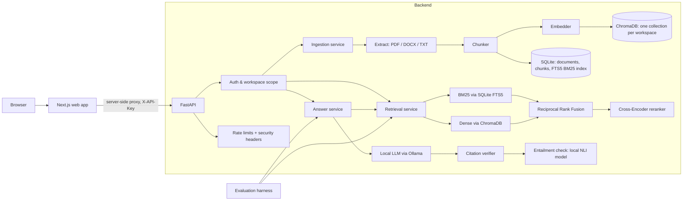

# Architecture & Plan

Status: **Phases 1–7 complete**, verified on a MacBook Air M4. Budget: **$0** (local models only). Everything marked *(planned)* below is design, not code yet.

## 1. System architecture



### Request flow for a question
1. API key → resolves to exactly one `workspace_id`. Every downstream query is scoped to it.
2. Dense retrieval (Chroma) returns the top 10. BM25 (FTS5) and RRF hybrid remain available per request, but measurements showed they add nothing once reranking is on.
3. The cross-encoder rescores those 10; the top-k go to the LLM.
4. *(Original plan: BM25 + dense fused with RRF, then rerank. The M4 benchmark showed dense + rerank is equal or better and simpler.)*
5. The local LLM (Ollama) sees passages fenced with a per-request random nonce as untrusted *data*, and must reply in JSON with `[n]` markers and an exact quote per cited passage.
6. The verifier checks every citation: the passage was actually shown, and the quote occurs in it (numbers and negations must match exactly). Sentences without a verified citation are removed; if nothing survives, the API returns `insufficient_evidence` rather than an unsupported answer. Source names and pages come from the database, never from the model.
7. A local NLI model (mDeBERTa-v3, multilingual) scores whether each remaining sentence *follows from* the passages it cites. Below the threshold the sentence is removed (or flagged, `EKA_ANSWER_ENTAILMENT_MODE=flag`). A real quote attached to a different claim no longer passes.

Before any of this, the request passes the auth-failure limiter (per client address) and the workspace's token bucket for `ask`; responses carry security headers. See [SECURITY.md](SECURITY.md).

## 2. Key design decisions

| Decision | Choice | Why | Upgrade path |
|---|---|---|---|
| BM25 engine | SQLite **FTS5** (`bm25()` ranking), **one table per workspace** | Persistent, zero extra deps; per-tenant tables give isolation by construction *and* correct per-tenant BM25 statistics (a shared table leaks term statistics across tenants); `rank_bm25` is in-memory and unmaintained | Postgres `tsvector` / OpenSearch |
| Workspace isolation in vectors | **One Chroma collection per workspace** | Isolation by construction, not by remembering a metadata filter on every query | Qdrant with payload-indexed tenants |
| Auth (MVP) | Per-workspace **API keys**, stored hashed | Real authorization from Phase 2, small surface | OIDC users + roles |
| Rate limiting | In-process **token buckets** per workspace (ask, search, ingest) and per client address (failed keys) | No extra service; correct for one process | Redis-backed limiter for several workers |
| Faithfulness check | Local **NLI cross-encoder** per answer sentence, after citation verification | Catches true quotes attached to wrong claims; multilingual; $0 | Larger NLI model or an LLM judge, if measured to help |
| Background ingestion | FastAPI `BackgroundTasks` + status column | No broker to run; status polling is enough for a single node | Celery/RQ or SQS worker |
| UI ↔ data | Next.js server proxies an **allowlist** of API calls; key in a sealed httpOnly cookie | Browser never holds the key; clean API boundary; CORS off | Per-user login (OIDC) instead of workspace keys |
| LLM access | `LLMClient` interface; **Ollama only** ($0 rule) + offline extractive stand-in | Local, free, private; stand-in keeps CI model-free | Any provider can implement the interface |
| Config | `pydantic-settings`, `EKA_` prefix | Typed, validated, fails fast at boot | AWS SSM / Secrets Manager |
| Logging | Std-lib JSON + request ID | No dependency, greppable, CloudWatch-friendly | OpenTelemetry |

Model choices for the MacBook M4 (16 GB) are in [MODELS.md](MODELS.md). Measured results, development and held-out, are in [evaluation/](evaluation/README.md).

## 3. MVP scope

**In:** workspace API keys; upload PDF/DOCX/TXT with size/type validation and duplicate detection (SHA-256); page-aware chunking; BM25 + dense + RRF + rerank; grounded answers with verified citations and an insufficient-evidence path; web UI (upload, documents, chat, citation panel); evaluation on a small hand-built dataset (~40 questions) comparing the four retrieval modes; Docker Compose; CI.

**Budget:** $0. Only free, open-source tools and local models; no paid APIs, no paid cloud resources.

**Out (roadmap):** OCR for scanned PDFs, Qdrant/Postgres migration, streaming responses, user accounts/RBAC, multi-node deployment, autoscaling.

## 4. Repository structure

```
enterprise-knowledge-ai/
├── app/
│   ├── main.py                 # app factory
│   ├── core/                   # config, logging, errors, middleware   ✅
│   │   ├── security.py         # API-key auth, workspace scope         ✅
│   │   └── ratelimit.py        # token buckets, client address         ✅
│   ├── api/routes/
│   │   ├── health.py           #                                       ✅
│   │   ├── workspace.py        #                                       ✅
│   │   ├── documents.py        # upload / list / delete / status       ✅
│   │   ├── search.py           # BM25 / dense / hybrid (RRF) search    ✅
│   │   ├── ask.py              # /ask, history, evidence               ✅
│   │   └── analytics.py        # usage analytics for the UI            ✅
│   ├── cli.py                  # workspace / API-key admin             ✅
│   ├── schemas/                # Pydantic request/response models      ✅
│   ├── db/                     # SQLAlchemy models + session           ✅
│   ├── repositories/           # workspace-scoped queries              ✅
│   └── services/
│       ├── storage.py          # local file storage (S3 in P8)         ✅
│       ├── ingestion/          # validation, extractors, chunker       ✅
│       ├── container.py        # service wiring (DI)                   ✅
│       ├── retrieval/          # embeddings, FTS5, Chroma, RRF, rerank ✅
│       ├── generation/         # Ollama client, prompts, verifier, NLI ✅
├── web/                        # Next.js + Tailwind + shadcn/ui          ✅
│   ├── src/app/                # pages; api/session, api/eka proxy, api/health
│   ├── src/components/         # answer view, sources, ui/ (shadcn)
│   ├── src/lib/                # format helpers, client; server/ session + proxy
│   └── e2e/                    # Playwright tests against the real API
├── eval/                       # datasets (dev + held-out), runners, SVG report ✅
├── scripts/                    # verify.sh, smoke_test.py              ✅
├── tests/                      # unit + API tests                      ✅
├── docs/                       # architecture, SECURITY.md, evaluation/, phases/
├── docker/ + docker-compose.yml#                                       (planned P8)
├── .github/workflows/ci.yml    #                                       ✅
├── pyproject.toml, requirements*.lock, Makefile, .env.example         ✅
```

## 5. Milestones (Oct 2026 → Feb 2027)

Target: a demo-able MVP **by early December** so it is on your CV while applications are open, with January as buffer.

| Week | Dates | Phase | Exit criterion |
|---|---|---|---|
| 1 | 10–18 Oct | 1 Setup | CI green, `/health` + tests ✅ |
| 2–3 | 19 Oct–1 Nov | 2 Ingestion + API-key auth ✅ | Upload 3 formats, chunks with page refs in SQLite, cross-workspace access test fails closed |
| 4 | 2–8 Nov | 3 BM25 + dense + RRF ✅ | `/search` with `bm25\|dense\|hybrid`; benchmark on Apple silicon |
| 5 | 9–15 Nov | 4 Rerank + fusion tuning ✅ | dense + rerank 10 by default (MRR 0.962), chosen from measurements |
| 6–7 | 16–29 Nov | 5 Grounded QA ✅ | Answers with verified citations; injection test docs don't change behaviour |
| 8 | 30 Nov–6 Dec | 6 Web UI, Next.js ✅ | **MVP demo** — record screenshots/GIF |
| 9–10 | 7–20 Dec | 7 Eval + hardening ✅ | Held-out set, charts, entailment check, rate limits, security headers, dependency audit |
| 11–12 | 21 Dec–3 Jan | 8 Docker + AWS | `docker compose up` works; deployed once, costs documented |
| 13+ | Jan | Polish | README, demo video, interview notes |

Adjust around exams — phases are sized so any one can slip a week without breaking the next.
