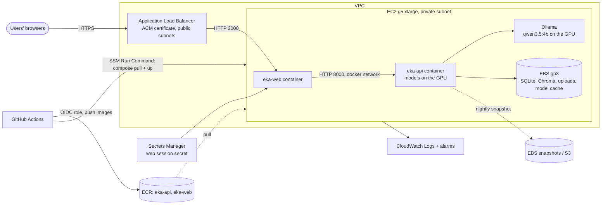

# AWS deployment design (not deployed)

**Status: design only.** Nothing in this document has been created on AWS, and the project needs no AWS account. That's deliberate: the budget is $0, and an AWS account needs a payment card. What runs and is tested today is the same containers on a laptop (`compose.yaml`) and in GitHub Actions. This document records how they would be deployed, what it would cost, and what would have to change first, so the design can be reviewed and discussed.

## Goals and constraints

- **Private by default.** Company documents and questions stay inside one AWS account and region; no third-party AI API sees them (the same promise the local version makes).
- **Same artefacts as local.** The `eka-api` and `eka-web` images that CI builds and tests are the ones deployed.
- **Small team first.** Tens of users, thousands of documents; one region, one availability zone for compute is acceptable at this stage.
- **Cost visible up front.** The GPU for the local LLM dominates the bill; the design makes it easy to stop when nobody is using it.

## Option A: one GPU instance (recommended first deployment)

| Concern | Choice | Why |
|---|---|---|
| Compute | One `g5.xlarge` (1× NVIDIA A10G with 22 GiB GPU memory, 4 vCPU, 16 GiB RAM) running the existing `compose.yaml` plus Ollama | The embedder, reranker, NLI model and the 4B LLM all fit on one A10G; no orchestration to operate |
| Network | VPC with public subnets for the ALB only; the instance in a private subnet with no public IP; security group allows port 3000 from the ALB only | Nothing on the instance is reachable from the internet; the API port is never exposed |
| TLS | ACM certificate on the ALB; HTTP→HTTPS redirect; HSTS added at the ALB/web layer | Free certificates, automatic renewal |
| Access for operators | SSM Session Manager, no SSH keys, no bastion | No inbound port 22; every session is logged |
| Storage | EBS gp3 volume for `/data` and the Hugging Face cache; nightly EBS snapshots (Data Lifecycle Manager) | The app's state is SQLite + Chroma files + uploads, which need a POSIX disk |
| Images | ECR, scan on push; images are the ones CI already built and tested | Same artefact from laptop to cloud |
| Secrets | `EKA_WEB_SESSION_SECRET` in Secrets Manager, written to the instance at deploy time | No secret in images, Git or user data |
| Deploys | GitHub Actions assumes an IAM role through OIDC (no stored AWS keys), pushes to ECR, then runs `docker compose pull && up -d` through SSM Run Command | Short-lived credentials; one auditable path to production |
| Observability | Docker `awslogs` driver to CloudWatch Logs (the API already logs JSON with request IDs); alarms on 5xx rate, `/health/ready` failing, disk > 80 %, GPU memory | Uses the logs and probes the app already has |
| App settings | `EKA_ENVIRONMENT=production` (API docs off), `EKA_TRUSTED_PROXIES` = VPC CIDR so rate limits see real client IPs, `EKA_WEB_COOKIE_SECURE=true` | Settings that exist today; nothing new to build |

### What it would cost

The GPU instance is almost the whole bill. Approximate on-demand list prices, checked October 2026; confirm in the [AWS Pricing Calculator](https://calculator.aws/) for the chosen region before relying on them:

| Item | Price used | Always on (730 h) | Office hours only (220 h/month) |
|---|---|---|---|
| EC2 `g5.xlarge`, us-east-1 | $1.006 / hour ([Holori, data of 10 Oct 2026](https://calculator.holori.com/aws/ec2/g5.xlarge/us-east-1)) | ≈ $734 | ≈ $221 |
| Application Load Balancer | $0.0225 / hour + $0.008 per LCU-hour (us-east-2 list price, [CloudZero](https://cloudzero.com/blog/aws-alb-pricing)) | ≈ $16 + usage | ≈ $16 + usage (the ALB stays on) |
| EBS gp3 (100 GB), snapshots, ECR, CloudWatch, Secrets Manager | small at this size | tens of dollars | tens of dollars |

Ways to cut it: stop the instance outside office hours (EventBridge Scheduler + SSM automation; EBS data persists); Savings Plans for steady use; a smaller GPU family if the quality benchmark (`make heldout`) still passes on it. Every model swap must be re-measured, because the benchmarks are what justify the current choices.

**About the AWS Free Tier:** since July 2025 new accounts get up to $200 in credits and a six-month free plan ([AWS announcement](https://aws.amazon.com/about-aws/whats-new/2025/07/aws-free-tier-credits-month-free-plan/)). That would cover a few days of an always-on GPU instance, not a running service, and signing up needs a payment card, so this project doesn't use it.

## Option B: managed LLM instead of the GPU instance

Replace Ollama with a model on Amazon Bedrock and run the containers on a CPU instance or ECS Fargate. The app already has an `LLMClient` interface (`app/services/generation/llm.py`), so this is one new client class plus settings.

- **For:** no GPU to run or patch; pay per token, so a quiet month costs little.
- **Against:** per-token cost grows with use; the embedder, reranker and NLI model still need CPU time (measured in Docker on the M4: see the Phase 8 notes); it breaks this project's "no paid API" rule, so it stays a documented option.

## Option C: what scaling past one instance needs

Running several API replicas behind the ALB needs code changes first. They are listed honestly here rather than hidden:

| Today (single process) | Needed for several replicas | Why |
|---|---|---|
| SQLite + FTS5 | Amazon RDS for PostgreSQL with `tsvector` (BM25-style) and `pgvector` | SQLite is one writer on one disk |
| Embedded Chroma on local disk | `pgvector` in the same database, or OpenSearch | Shared vector index |
| Uploads on local disk (`LocalFileStorage`) | Amazon S3 (`storage.py` already isolates file access behind one class) | Any replica can read any file |
| In-memory rate limits | ElastiCache (Redis/Valkey) token buckets | Limits must be shared (see [SECURITY.md](SECURITY.md)) |
| FastAPI background tasks for ingestion | SQS queue + worker service | Uploads survive a replica restart |
| Workspace API keys | Cognito or the company's identity provider (OIDC) | Per-user accounts and roles |

## What is done vs designed

| | Done and tested | Designed only |
|---|---|---|
| Container images (API ml/lite, web), non-root, read-only filesystem | ✅ local + CI | |
| Compose stack with health checks, localhost-only ports | ✅ local + CI | |
| CI building images and running an end-to-end smoke test | ✅ | |
| VPC, ALB, ACM, EC2 GPU instance, ECR, SSM, CloudWatch, Secrets Manager | | ✅ this document |
| OIDC deploy from GitHub Actions | | ✅ this document |
| Multi-replica changes (Postgres, S3, Redis, SQS, OIDC users) | | ✅ this document |
