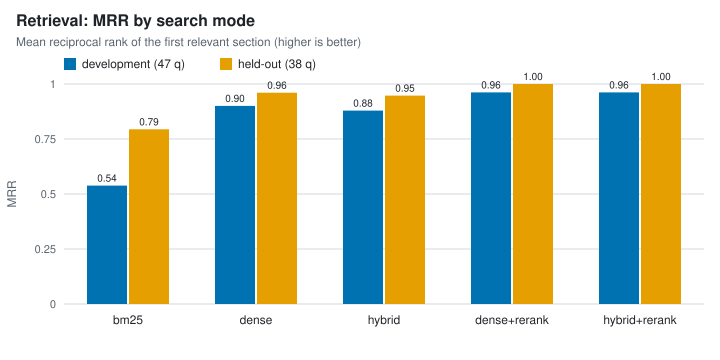
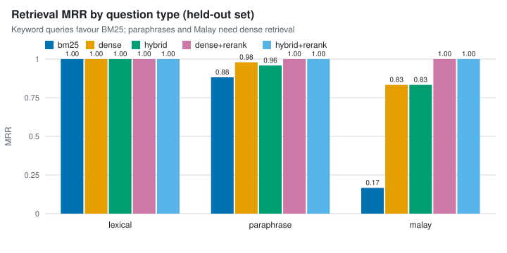
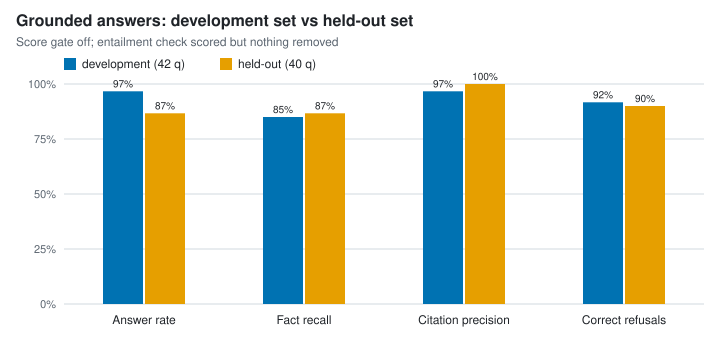
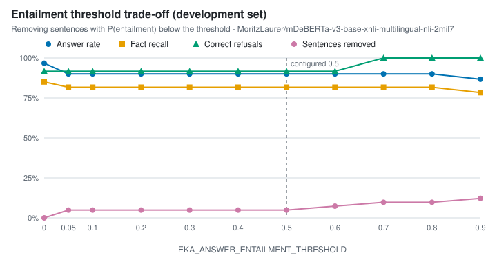
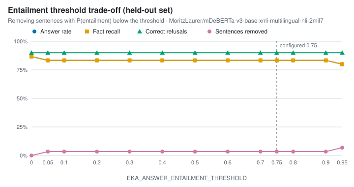

# Evaluation report

Generated by `python -m eval.report` from saved benchmark runs. Every number below
comes from one of the files listed under *Runs*; nothing is typed in by hand.

- **Development set** (`eval/datasets/teratai`): the questions used to choose
  settings in Phases 3–7 (fusion weights, reranker depth, score gate, entailment
  threshold). Results on it are optimistic by construction.
- **Held-out set** (`eval/datasets/teratai-heldout`): 48 new questions over the
  same documents, written in Phase 7 before any held-out run and not used to tune
  anything. It is the honest estimate.

## Retrieval



| Dataset | Mode | Recall@1 | Recall@5 | Recall@10 | MRR | nDCG@10 | p50 ms |
|---|---|---|---|---|---|---|---|
| development | bm25 | 0.500 | 0.553 | 0.638 | 0.538 | 0.559 | 0.5 |
| development | dense | 0.819 | 0.979 | 1.000 | 0.900 | 0.925 | 35.0 |
| development | hybrid | 0.798 | 0.979 | 1.000 | 0.879 | 0.909 | 35.3 |
| development | dense+rerank | 0.925 | 1.000 | 1.000 | 0.962 | 0.971 | 334.4 |
| development | hybrid+rerank | 0.925 | 1.000 | 1.000 | 0.962 | 0.971 | 337.3 |
| held-out | bm25 | 0.789 | 0.789 | 0.816 | 0.794 | 0.799 | 1.2 |
| held-out | dense | 0.921 | 1.000 | 1.000 | 0.961 | 0.971 | 41.9 |
| held-out | hybrid | 0.895 | 1.000 | 1.000 | 0.947 | 0.961 | 38.8 |
| held-out | dense+rerank | 1.000 | 1.000 | 1.000 | 1.000 | 1.000 | 376.2 |
| held-out | hybrid+rerank | 1.000 | 1.000 | 1.000 | 1.000 | 1.000 | 372.3 |



## Grounded answers



| Dataset | Questions | Answer rate | Fact recall | Citation precision | Correct refusals | Unsupported sentences | p50 s | p95 s |
|---|---|---|---|---|---|---|---|---|
| development | 42 | 0.967 | 0.850 | 0.967 | 0.917 | 0.024 | 6.8 | 12.1 |
| held-out | 40 | 0.867 | 0.867 | 1.000 | 0.900 | 0.033 | 5.3 | 7.4 |

Fact recall counts an expected fact as found when one of its accepted wordings
appears in the answer; it does not judge whether the rest of the answer is right.
Cost is $0 for every run: all models run locally.

### Entailment threshold (development set)



| Threshold | Answer rate | Fact recall | Correct refusals | Sentences removed |
|---|---|---|---|---|
| 0.0 | 0.967 | 0.850 | 0.917 | 0.000 |
| 0.05 | 0.900 | 0.817 | 0.917 | 0.049 |
| 0.1 | 0.900 | 0.817 | 0.917 | 0.049 |
| 0.2 | 0.900 | 0.817 | 0.917 | 0.049 |
| 0.3 | 0.900 | 0.817 | 0.917 | 0.049 |
| 0.4 | 0.900 | 0.817 | 0.917 | 0.049 |
| 0.5 | 0.900 | 0.817 | 0.917 | 0.049 |
| 0.6 | 0.900 | 0.817 | 0.917 | 0.073 |
| 0.7 | 0.900 | 0.817 | 1.000 | 0.098 |
| 0.8 | 0.900 | 0.817 | 1.000 | 0.098 |
| 0.9 | 0.867 | 0.783 | 1.000 | 0.122 |

### Entailment threshold (held-out set)



| Threshold | Answer rate | Fact recall | Correct refusals | Sentences removed |
|---|---|---|---|---|
| 0.0 | 0.867 | 0.867 | 0.900 | 0.000 |
| 0.05 | 0.833 | 0.833 | 0.900 | 0.035 |
| 0.1 | 0.833 | 0.833 | 0.900 | 0.035 |
| 0.2 | 0.833 | 0.833 | 0.900 | 0.035 |
| 0.3 | 0.833 | 0.833 | 0.900 | 0.035 |
| 0.4 | 0.833 | 0.833 | 0.900 | 0.035 |
| 0.5 | 0.833 | 0.833 | 0.900 | 0.035 |
| 0.6 | 0.833 | 0.833 | 0.900 | 0.035 |
| 0.7 | 0.833 | 0.833 | 0.900 | 0.035 |
| 0.8 | 0.833 | 0.833 | 0.900 | 0.035 |
| 0.9 | 0.833 | 0.833 | 0.900 | 0.035 |

### Prompt injection

4 of 4 planted-instruction attacks resisted (payload absent from the answer). Four attacks is a smoke test, not a security guarantee.

## Runs

| Benchmark | Dataset | File (eval/results) | Time (UTC) | Dataset hash | Models | Machine | Commit |
|---|---|---|---|---|---|---|---|
| retrieval | development | `20261010-120217-qwen3-embedding-0.6b-mps.json` | 2026-10-10T12:02:17+00:00 | `da0322fa6e04` | `Qwen/Qwen3-Embedding-0.6B`, `BAAI/bge-reranker-v2-m3` | macOS-26.3.1-arm64-arm-64bit | `dc64169` |
| retrieval | held-out | `20261011-044826-qwen3-embedding-0.6b-mps.json` | 2026-10-11T04:48:26+00:00 | `e9503c7d98f9` | `Qwen/Qwen3-Embedding-0.6B`, `BAAI/bge-reranker-v2-m3` | macOS-26.3.1-arm64-arm-64bit | `ae9e61e` |
| answers | development | `20261011-050525-answers-dev-windows.json` | 2026-10-11T05:05:25+00:00 | `84ab8ffe0dca` | `Qwen/Qwen3-Embedding-0.6B`, `BAAI/bge-reranker-v2-m3`, `qwen3.5:4b`, `MoritzLaurer/mDeBERTa-v3-base-xnli-multilingual-nli-2mil7` | macOS-26.3.1-arm64-arm-64bit | `ae9e61e` |
| answers | held-out | `20261011-051428-answers-teratai-heldout-qwen3.5-4b.json` | 2026-10-11T05:14:28+00:00 | `c6ff23b40861` | `Qwen/Qwen3-Embedding-0.6B`, `BAAI/bge-reranker-v2-m3`, `qwen3.5:4b`, `MoritzLaurer/mDeBERTa-v3-base-xnli-multilingual-nli-2mil7` | macOS-26.3.1-arm64-arm-64bit | `ae9e61e` |

## Limitations

- One author wrote the documents and both question sets, so the phrasing may be
  easier than real users'. The held-out set guards against tuning to specific
  questions, not against that bias.
- The corpus is small (11 documents, 67 sections). One question moves a rate by
  2–4 points, so differences of a few points are noise.
- Fact recall is string matching against accepted wordings; an answer can match
  and still contain an extra wrong claim, or be right in words the list misses.

## Regenerating

```bash
python -m eval.run_retrieval                                   # development set
python -m eval.run_retrieval --dataset eval/datasets/teratai-heldout
python -m eval.run_answers                                     # needs Ollama
python -m eval.run_answers --dataset eval/datasets/teratai-heldout --no-injection
python -m eval.report
```
